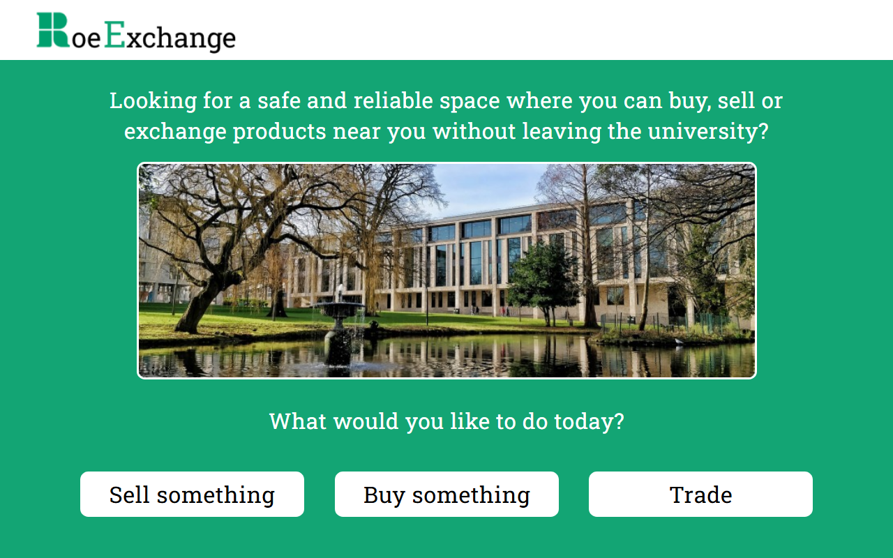

# RoeExchange (original version)

A university project: a marketplace where University of Roehampton students can buy, sell and swap items without leaving campus. This is the original coursework version; the redesign is in [roe-exchange](https://github.com/RodrigoPerez2803/roe-exchange).

**Live site:** https://rodrigoperez2803.github.io/roe-exchange-original/

## What it covers

- A multi-page prototype of the main journeys: creating an account (personal details and college), buying from the store by category, selling an item and proposing a trade.
- Simple form validation, picture previews and on-screen messages.
- Sign-up details are remembered in `localStorage`.

Built with plain HTML, CSS and JavaScript. Open `index.html` in a browser.

*Listings are sample data, and nothing typed into the forms is sent anywhere.*
